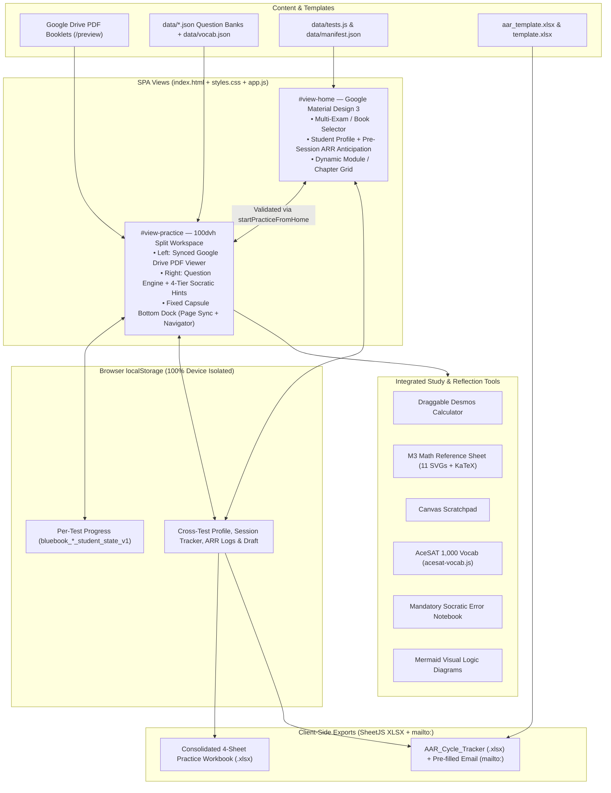

# Vinschool Digital SAT Bluebook Application — Architecture & Build Skill

Blueprint and operational specification for reproducing or extending the static-first **Digital SAT Bluebook Multi-Exam & Textbook Practice Platform** deployed at `https://mikepham358.github.io/vinschool-sat-team/` (repository: `https://github.com/mikepham358/vinschool-sat-team`).

---

## 1. System Architecture Overview

The application is a zero-build, static HTML/CSS/Vanilla-JS Single Page Application hosted on **GitHub Pages** (`/`), synchronized identically with `static/` for optional local/tunnel execution via a zero-dependency Python HTTP server (`server.py`). All student state lives strictly in browser `localStorage` for full multi-student isolation without accounts or databases.



---

## 2. Repository Layout & Dual-Mirror Invariant

```text
vinschool-sat-team/
├── index.html                        # SPA entry point (GitHub Pages root)
├── styles.css                        # Material Design 3 + Bluebook split-screen CSS
├── app.js                            # Client state machine, Socratic engine, ARR, XLSX export
├── acesat-vocab.js                   # AceSAT 1,000 vocabulary modal module
├── aar_template.xlsx                 # Official AAR Cycle Tracker workbook template
├── template.xlsx                     # Exam score export template
├── poster.png / poster_sep.png       # Hero showcase assets
├── data/
│   ├── tests.js                      # window.TESTS_MANIFEST (primary client manifest)
│   ├── manifest.json                 # JSON mirror of available exams/books
│   ├── vocab.js / vocab.json         # AceSAT 1,000 word lists
│   ├── oct2026.json / sep2026.json   # Real Test INT-B & INT-A (98 Qs each)
│   ├── erica_reading.json / ericareading.json  # Erica Meltzer Reading (101 Qs)
│   ├── panda_math.json / pandamath.json        # College Panda Math (330 Qs)
│   └── erica_writing.json / ericawriting.json  # Erica Meltzer 6th Grammar (334 Qs)
├── static/                           # Byte-for-byte mirror for server.py / local runtime
│   ├── index.html, styles.css, app.js, acesat-vocab.js
│   ├── aar_template.xlsx, template.xlsx, poster*.png
│   └── data/...
├── server.py                         # Optional local HTTP server (/api/data, /api/submit-aar, /api/export-excel)
├── add_new_test.py                   # CLI tool to register new exam datasets
├── start.sh / tunnel.sh              # Local launch + Cloudflare Tunnel wrappers
└── .agents/skills/vinschool-sat-team/SKILL.md
```

**Critical Engineering Rule — Root / `static/` Parity:**
GitHub Pages serves from the repository root (`/`), while `server.py` serves from `static/`. Whenever `index.html`, `styles.css`, `app.js`, `acesat-vocab.js`, templates, or `data/*` are edited at root, mirror them immediately into `static/` and verify zero drift with `diff -q`.

---

## 3. Core Tech Stack & CDN Dependencies

Loaded directly in [`index.html`](../../../index.html) without any bundler or runtime build step:
- **KaTeX (`0.16.8`)**: `katex.min.css`, `katex.min.js`, and deferred `auto-render.min.js` for question stems and Math Reference Sheet formulas.
- **SheetJS (`xlsx@0.18.5`)**: Pure client-side Excel generation (`XLSX.read`, `XLSX.utils`, `XLSX.write`) working offline and on GitHub Pages without a backend.
- **Mermaid (`10.9.1`)**: Renders post-solve visual reasoning flowcharts in `#modal-mermaid` with pan/zoom.
- **Typography**: Google Fonts `Inter` (UI) and `JetBrains Mono` (timers, counters, badges).

---

## 4. Registered Datasets & Question Schema

### Active Catalog (`data/tests.js` / `data/manifest.json`)

| ID / Alias | Code | Dataset | Questions | Modules / Units | PDF Drive ID |
| :--- | :--- | :--- | :---: | :---: | :--- |
| `oct-2026` | `oct2026` | Digital SAT Practice Test — October 2026 (INT-B) | 98 | 4 Modules | `1Qiu34_dltehpEVmfHvOivjAvf8Zkd77b` |
| `sep-2026` | `sep2026` | Digital SAT Practice Test — September 2026 (INT-A) | 98 | 4 Modules | `1dt6Up_Tz-B_h48JVLeIPF8vMwWWPxVSL` |
| `erica-reading` | `ericareading` | The Critical Reader: SAT Reading (Erica Meltzer) | 101 | 9 Chapters | `10d5oocFy5VfhLfP1ZB88xAGRe-5TFl7Z` |
| `panda-math` | `pandamath` | The College Panda SAT Math (Nielson Phu) | 330 | 27 Chapters | `1z4CC7X-L3e3XZr04uc7RgMZBK5lYs8Gb` |
| `erica-writing` | `ericawriting` | The Ultimate Guide to SAT Grammar 6th Ed. (Erica Meltzer) | 334 | 17 Units | `1RRTBIfpSDD6AyaPJNmfK54fyoXmvNu-s` |

Deep linking via query parameter `?test=<id|code>` (resolved in `getActiveTestMeta()` / URL loader) opens any source directly.

### Standard Question Object Keys (`data/*.json`)

```json
{
  "id": 1,
  "master_id": "Q1",
  "q_number": 1,
  "q_label": "Ch.5 - Câu 11",
  "category": "practice",
  "category_label": "Bài tập thực hành",
  "module_code": "Ch5_JoiningClauses",
  "module_title": "Chương 5: Joining Sentences and Fragments",
  "section": "Writing",
  "topic": "Ch5 - Punctuation",
  "domain": "Standard English Conventions",
  "pdf_page": 81,
  "book_page": 79,
  "difficulty": "Medium",
  "passage": "...",
  "prompt": "...",
  "options": { "A": "...", "B": "...", "C": "...", "D": "..." },
  "is_grid_in": false,
  "correct_answer": "A",
  "acceptable_answers": ["A"],
  "tier1_hint": "...",
  "tier2_hint": "...",
  "tier3_hint": "...",
  "strategic_tip": "...",
  "mermaid_diagram": "flowchart TD..."
}
```

### Mandatory Pedagogical Rule: Spoiler-Free Tier 1 & Tier 2
- **Tầng 1 (`tier1_hint`)**: Context orientation and reading/math strategy cues **only**.
- **Tầng 2 (`tier2_hint`)**: Structural clues, elimination framework, or formula selection **without stating `[correct_answer]`**.
- **Tầng 3 (`tier3_hint`)**: Unlocks only after correct answer or 3 failed attempts; reveals full solution and exact `[correct_answer]`.
- **Tầng 4 (`strategic_tip`) + Mermaid**: Unlocks alongside completion for transferrable College Board test strategy.

---

## 5. UX Architecture & Key Subsystems

### View 1: Google Material Design 3 Home Page (`#view-home`)
- **Exam Hub Dropdown (`#select-active-exam`)**: Switches active source cleanly without clearing any other exam's progress.
- **Student Profile + Pre-Session ARR Anticipation (`#form-home-profile` & `#home-anticipation-box`)**:
  - Captures Student Name (`#home-input-name`), Email (`#home-input-email`), and SAT Target chips (`1300+`, `1400+`, `1500+`).
  - Embeds Stage 1 Anticipation directly above `#btn-home-start-practice`: Session `#` (`#home-aar-session`), Expected SAT Module (`#home-aar-sat-module` + `#home-aar-sat-module-custom`, mirrored dynamically from modal selects via `initHomeAarSelects()`), ISTE Standard (`#home-aar-iste` with auto-suggestion from `getEffectiveModuleForIste()`), Learning Goal + Target pill (`#home-aar-goal`), and Expected Challenge (`#home-aar-challenge`).
  - Sync badge `#home-aar-sync-badge` switches to `✓ Đã đồng bộ sẵn vào ARR` when Goal & Challenge are filled; `startPracticeFromHome()` blocks entering `#view-practice` via `flagHomeFieldError()` until all required profile and Anticipation fields are completed and saved to `localStorage`.
- **Dynamic Module / Chapter Cards (`#modules-grid`)**: Displays exact question counts, example/practice breakdown, page ranges, and live progress.

### View 2: Split-Screen Bluebook Workspace (`#view-practice`)
- **Fixed Viewport Layout (`styles.css`)**:
  - `.view-practice` uses `position: fixed; inset: 0; height: 100dvh; display: flex; flex-direction: column; overflow: hidden;` so header (`flex-shrink: 0`), flexible split-pane (`flex: 1 1 0; min-height: 0`), and bottom dock (`flex-shrink: 0`) never push `.bluebook-footer` off-screen across `1440×900` down to `320×568` phones or landscape viewports (`844×390`). Supports iOS safe areas (`viewport-fit=cover`, `env(safe-area-inset-bottom)`) and Zen Mode (`Z`).
  - Mobile header (`<= 850px`): `.header-section-info` keeps `flex-shrink: 0;` inside the horizontally scrollable `.bluebook-header` so `.header-timer` never overlaps `#btn-home`.
- **Left Pane (`#pane-pdf`)**: Embedded Google Drive `/preview` viewer synced to question `pdf_page` + tablet pane toggle (`#btn-toggle-pdf` / `#btn-toggle-question`).
- **Right Pane (`#pane-content`)**: MCQ (`A/B/C/D` + Eliminator strikethrough) and Math Grid-in parser (accepting integers, decimals, and fractions `a/b`), 3-attempt efficiency scoring (`1.0`, `0.67`, `0.33`), and mandatory Error Reflection gate before advancing after wrong answers.
- **Persistent Bottom Bar (`.bluebook-footer`)**: Always keeps `#pdf-page-badge` (`📖 Câu này ở Trang X`), `#btn-open-navigator` (`Question N of M ▲`), topic/domain badges, and `Back` / `Next`.
- **Top Obsidian Header Controls**:
  - **Cross-Test Session Cluster (`.header-timer-cluster`)**: Module countdown timer, persistent cross-test practiced question counter (`#header-session-counter`), and Reset Test button (`#btn-reset-test`). *(Legacy exam-finish flow removed in favor of continuous session tracking + ARR reporting.)*
  - **Study Tool Dock**: Desmos (`#modal-calculator`), Math Reference Sheet (`#modal-reference`), Handwriting Scratchpad (`#scratchpad-drawer`), Socratic Error Notebook (`#modal-error-log`), AceSAT 1,000 Vocab (`#modal-acesat-vocab`), Consolidated Excel Export (`#btn-export-excel`), and ARR Report (`#btn-open-aar`).

### Google Material 3 Math Reference Sheet (`#modal-reference`)
- Categorized filter bar (`#ref-filter-chips`: `Tất cả`, `2D & Pythagore`, `Tam giác đặc biệt`, `Thể tích 3D`, `Quy tắc góc`) with `Esc` and backdrop dismissal.
- 11 vector geometry SVG diagrams (2D shapes, proportionally exact `45°–45°–90°` & `30°–60°–90°` triangles, and 3D wireframe solids with dashed hidden edges and altitudes).
- Every formula stores LaTeX in `.ref-tex[data-tex]` alongside clean semantic HTML/CSS fallback markup (`.mf-frac`, `.mf-sqrt`) — upgraded via `renderReferenceSheetMath()` (`katex.render`) so raw `\(` delimiters never appear online or offline.

---

## 6. State Isolation & Persistence Keys (`localStorage`)

| Key / Constant | Scope | Purpose |
| :--- | :--- | :--- |
| `getStorageKeyForTest(id)` (`bluebook_<test>_student_state_v1`) | Per test/book | Answers, attempt history, efficiency scores, bookmarks, eliminations, module timers, error logs |
| `GLOBAL_PROFILE_KEY` (`bluebook_global_student_profile_v1`) | Global | Student name, email, and SAT score target (`1300+` / `1400+` / `1500+`) |
| `GLOBAL_AAR_DRAFT_KEY` (`bluebook_global_aar_draft_v1`) | Global | Pre-session Anticipation draft synced two-way between Home and ARR modal |
| `GLOBAL_AAR_STORAGE_KEY` (`bluebook_global_aar_tracker_v1`) | Global | Completed ARR session logs rendered in History tab & AAR Excel journal |
| `GLOBAL_SESSION_TRACKER_KEY` (`bluebook_global_session_tracker_v1`) | Global | Cross-test / mixed-source session tracker powering `.header-session-counter` & ARR performance metrics |

---

## 7. Reporting & Excel Export Specifications

### A. AAR / ARR Cycle Report (`#modal-aar-report`)
1. **Stage 0 & 1 (Auto-synced from Home & Session Tracker)**: Pre-populates student identity, SAT target pill, Session `#`, SAT Module (includes `Mix (Nhiều mô-đun / Tài liệu kết hợp)` and `Khác (Tự nhập...)`), ISTE standard, Goal, Challenge, and automatic quantitative performance (`correct_count / practiced_count`, Socratic tier breakdown, mixed-source summary).
2. **Stage 2 & 3 (Student Self-Reflection — Starts Blank)**:
   - `#aar-input-tools`, `#aar-select-mastery` (required `*`), `#aar-input-gap` (opens empty; optional manual `#btn-aar-pull-errors` helper), `#aar-input-feedforward` (required `*`), `#aar-select-emotion`, and `#aar-select-status` all initialize empty (`""`) with zero silent defaults.
   - `collectAARFormEntry(true)` validates all `*` fields before submission; `submitAARReport()` resets both `App.aarDraft` and all Stage 2/3 fields for the next study session (`Buổi N+1`).
3. **Output**: Downloads formatted `AAR_Cycle_Tracker_<Student>_<Date>.xlsx` built on `aar_template.xlsx`, triggers `mailto:` to `AAR_TEACHER_RECIPIENTS` (`v.sonpbh1@vinschool.edu.vn,mikepham@baoan.ai.vn`) with `CC` to student email, and saves to History.

### B. Consolidated 4-Sheet Practice Workbook (`#btn-export-excel`)
Generates client-side `.xlsx` combining all practiced questions across mixed sources in four sheets:
1. `Hieu_Suat_Lam_Bai` — Overall accuracy, Socratic weighted efficiency, and breakdown by source/module.
2. `Cau_Hoi_Da_Thuc_Hanh` — Every practiced item with passage/prompt, student choices per tier, L1/L2/L3/Strategic hints, and correctness.
3. `So_Tay_Thu_Sai_Socratic` — Error log entries with root-cause trap classification and student takeaway rules.
4. `Tu_Vung_Socratic` — Recorded vocabulary notes and study entries.

---

## 8. Adding a New Exam or Textbook

1. Prepare normalized question array JSON in `data/<new_id>.json` (follow keys in Section 4; verify PDF page alignment against the source Google Drive PDF; verify Tier 1 & Tier 2 contain **zero answers**).
2. Add an entry to both `data/tests.js` (`window.TESTS_MANIFEST`) and `data/manifest.json` (or run `python3 add_new_test.py` for standard 98-question PDF tests).
3. Copy updated assets to `static/data/` so `diff -qr data static/data` exits `0`.

---

## 9. Verification Checklist (Run Before Every Push)

After any code edit in `vinschool-sat-team`:
1. Mirror modified root assets (`index.html`, `styles.css`, `app.js`, `data/*`) into `static/` and confirm parity:
   ```bash
   node --check app.js && node --check static/app.js
   diff -q index.html static/index.html && diff -q styles.css static/styles.css && diff -q app.js static/app.js
   ```
2. Run browser end-to-end checks over a local HTTP server (Playwright / headless Chromium) covering:
   - Hero profile + Anticipation validation, reload persistence, two-way ARR sync, blank Stage 2/3 defaults, and `.xlsx` export inspection (`openpyxl`).
   - Math Reference Sheet KaTeX rendering (`0` raw `\(` strings), SVG bounding boxes, category filter chips, and `Esc` dismissal.
   - Bottom dock visibility (`#pdf-page-badge` + `#btn-open-navigator`) across desktop, tablet, portrait phone (`320px–390px`), and landscape phone (`844×390`), plus Zen Mode.
   - Cross-exam loading & switching across all 5 registered datasets with `0` console or uncaught page errors.
